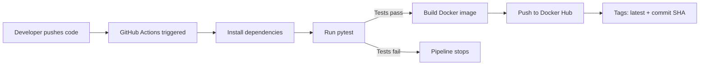
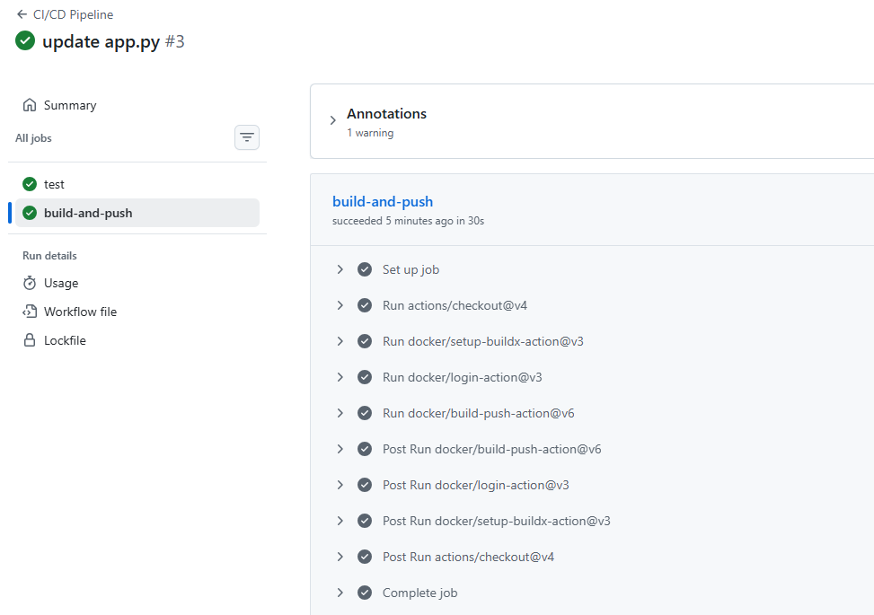
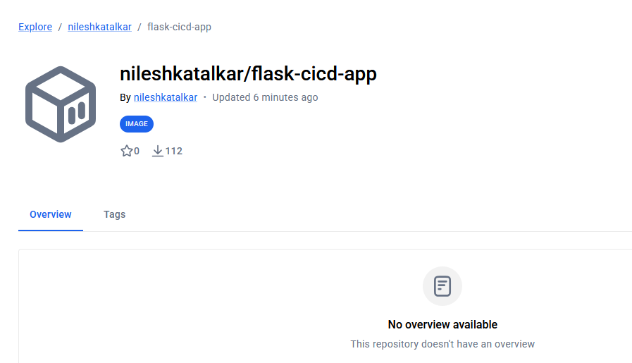
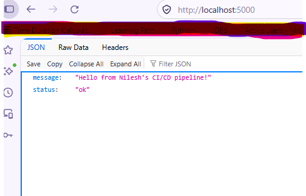

# Flask CI/CD Pipeline


A small Flask application with a fully automated CI/CD pipeline. Every push to `main` runs the tests, builds a Docker image, and publishes it to Docker Hub, with no manual steps.

## Pipeline Overview



| Job | Runs on | What it does |
|-----|---------|--------------|
| `test` | Every push and pull request | Installs dependencies and runs `pytest` |
| `build-and-push` | Push to `main` only, after `test` passes | Builds the Docker image and pushes it to Docker Hub |

Each image is tagged twice:
- `latest`: the most recent build
- `<commit SHA>`: traceable back to the exact code that produced it

## Tech Stack

- **Application:** Python, Flask, Gunicorn
- **Testing:** Pytest
- **Containerization:** Docker
- **CI/CD:** GitHub Actions
- **Registry:** Docker Hub

## Project Structure

```
flask-cicd-pipeline/
├── .github/
│   └── workflows/
│       └── ci.yml          # CI/CD pipeline definition
├── app.py                  # Flask application
├── test_app.py             # Unit tests
├── requirements.txt        # Python dependencies
├── Dockerfile              # Container image definition
├── .dockerignore
└── README.md
```

## API Endpoints

| Endpoint | Description | Example response |
|----------|-------------|------------------|
| `GET /` | Welcome message | `{"message": "...", "status": "ok"}` |
| `GET /health` | Health check | `{"status": "healthy"}` |

## Run Locally

### Option 1: Python

```bash
git clone https://github.com/Nileshk27/flask-cicd-pipeline.git
cd flask-cicd-pipeline

python -m venv venv
source venv/bin/activate        # Windows: venv\Scripts\activate
pip install -r requirements.txt

pytest                          # run the tests
python app.py                   # start the app on http://localhost:5000
```

### Option 2: Docker

```bash
docker build -t flask-cicd-app .
docker run -p 5000:5000 flask-cicd-app
```

Or pull the published image:

```bash
docker pull <your-dockerhub-username>/flask-cicd-app:latest
docker run -p 5000:5000 <your-dockerhub-username>/flask-cicd-app:latest
```

Then open http://localhost:5000.

## Set Up the Pipeline on Your Own Fork

1. Create a Docker Hub **access token** (Account Settings → Personal access tokens, Read & Write).
2. In your GitHub repo, go to **Settings → Secrets and variables → Actions** and add:

   | Secret | Value |
   |--------|-------|
   | `DOCKERHUB_USERNAME` | Your Docker Hub username |
   | `DOCKERHUB_TOKEN` | The access token from step 1 |

3. Push a commit to `main` and watch the **Actions** tab.

Credentials are stored only as GitHub Secrets. Nothing sensitive is committed to the repository.

## Screenshots

<!-- Add your own screenshots to a /docs folder and update the paths below -->

**Successful pipeline run**



**Image published on Docker Hub**



**App running in the browser**



## What I Learned

- Designing a multi-job GitHub Actions workflow with job dependencies (`needs`)
- Restricting deployment steps to the `main` branch with conditions
- Writing a lean, production-style Dockerfile using a slim base image and Gunicorn
- Handling credentials safely with GitHub Secrets and Docker Hub access tokens
- Tagging images with commit SHAs for traceability

## Possible Improvements

- Add linting (flake8) and a security scan (Trivy) as pipeline stages
- Deploy the image automatically to AWS (ECS or EC2) after the push
- Add Docker layer caching to speed up builds

## Author

**Nilesh Katalkar**
[LinkedIn](https://linkedin.com/in/nilesh-katalkar-984385195/) · [Digital Resume](https://nileshk27.github.io/resume/) · [GitHub](https://github.com/Nileshk27)
